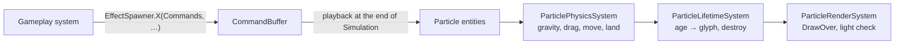

# Rendering and effects

How a frame of EternalDigger gets onto the screen: the `Canvas` every renderer draws through, the light map, how
tiles, the house and the miner are drawn, and the particle pipeline behind every effect.

## Draw order

The Presentation group draws in `Add` order, each layer over the last:

| # | System | Draws | Covers |
|---|---|---|---|
| 1 | `SkyRenderSystem` | Sky gradient, sun, clouds, hills | Every screen cell above the grass |
| 2 | `TerrainRenderSystem` | Every tile from the grass row down, by light level (24-bit: by smooth light, [24-bit terrain](#24-bit-terrain)) | Every screen cell from the grass down (the mine's 30 columns) |
| 3 | `HouseRenderSystem` | House, sign, chimney smoke, ladder shop, `MINE` frame, `LIFT` sign | Fixed spots on the surface |
| 4 | `ElevatorRenderSystem` | Shaft walls and braces, cable, car, speed lines | The shaft column (and the cells beside it), over terrain |
| 5 | `CampRenderSystem` | The deep camp once bought: tent `/▀\` (dark yellow, dark-grey door), flickering lantern `¤` on a pole, `CAMP` plank, crate | Columns 22–24, rows 109–110 |
| 6 | `DynamiteRenderSystem` | Planted sticks: red `¡` with a `*` fuse flickering yellow/red above it | The stick's tile, in the dark too |
| 7 | `ParticleRenderSystem` | Every particle glyph and rubble body ([Rubble](#rubble-bodies)), except on the miner's cells; in 24-bit colour mist and gas as see-through tints ([Blended overlays](#blended-overlays)) | Over the world, keeping its background |
| 8 | `MinerRenderSystem` | The 4 × 2 miner and the lamp glow (a jump draws him up to 2 cells higher, in an arc) | Over the world and the particles |
| 9 | `FloatingTextRenderSystem` | `+150g` / `-10g` / `ELEVATOR +10m` / `OIL +40` / `GAS!` / `BLACK DAMP` | Over everything so far |
| 10 | `PromptRenderSystem` | The door prompt, the counter panels (surface and deep camp), the lift sign and landing prompts, the dynamite hints; see-through in 24-bit colour | Above the miner |
| 11 | `HudSystem` | The two top rows | Screen rows 0–1 |
| 12 | `InventorySystem` | The `TAB` inventory panel, 60 × 20, double frame, yellow on dark blue (see-through deep navy in 24-bit colour) | The middle of the screen, over everything, while open |

Layers 1 and 2 together paint every cell of the screen each frame. That matters for the `Canvas`.

## Canvas: drawing without black boxes

The engine's `RenderConsole.Draw(x, y, char, fg, bg)` always sets the background. A glint over a gold tile, debris
in front of the house or a coin against the sky would each punch a black (or wrongly coloured) box into the scene,
and the engine has no public way to read a cell's colour back.

`Rendering/Canvas.cs` wraps the `RenderConsole` and keeps the background of every screen cell: a `ConsoleColor[]`
for palette cells and a `uint[]` for 24-bit cells. It also keeps each cell's character and its foreground as 24-bit
colour (a palette colour as `Rgb.Of`), so an overlay can blend into the cell ([Blended overlays](#blended-overlays)).

| Method | Does |
|---|---|
| `Draw(x, y, char, fg, bg)` | Draws in the 16 colours and records `bg` for the cell. Clips to the screen |
| `DrawRgb(x, y, char, fgRgb, bgRgb)` | Draws in 24-bit colour (`0xRRGGBB`) and records `bgRgb`. Clips to the screen |
| `Draw(x, y, ReadOnlySpan<char>, fg, bg)` | The same as `Draw` for text |
| `DrawOver(x, y, char, fg)` | Draws a character with the background **already recorded** at that cell; over a 24-bit cell the `ConsoleColor` foreground is drawn as its RGB (`Rgb.Of`) on that 24-bit background |
| `Tint(x, y, rgb, alpha)` | Lays `rgb` over the cell with opacity `alpha`: keeps the character, blends foreground and background towards it (`Rgb.Mix`). 24-bit only; does nothing off-screen or at `alpha` ≤ 0 |
| `DrawGlass(x, y, char, fgRgb, fillRgb, alpha)` | Draws a character on the recorded background blended towards `fillRgb` by `alpha`: a see-through panel cell |
| `DrawPanel(x, y, char, fg, PanelFill)` | A panel cell: `Draw` on `PanelFill.Color` in the 16 colours (exactly as before), `DrawGlass` with `PanelFill.Rgb`/`Alpha` while `IsTrueColor` |
| `BackgroundAt(x, y)` | The last palette background drawn there (black off-screen, and black for a 24-bit cell) |
| `BackgroundRgbAt(x, y)`, `ForegroundRgbAt(x, y)` | The cell's colours as 24-bit colour, palette or not (black off-screen) |
| `IsTrueColor` | `RenderConsole.TrueColorActive`: whether to draw the 24-bit look this frame |

Because the sky and the terrain cover every cell each frame, the recorded backgrounds are always this frame's. Rule
for new code: **world layers use `Draw`, things drawn on top use `DrawOver`.**

## Light

`Rendering/LightMap.cs` holds one byte per tile for the rows on screen. `LightingSystem` recomputes it every frame,
right after the camera moved, from the miner's sliding `Position` (so the light glides along with them) and
`Miner.LampDirection`.

```text
for each tile on screen
  level = max(daylight(tile), lamp(tile))
  if level > Dark: mark the tile Seen

daylight: depth ≤ 0 → Bright
          depth 1–3 and dug out (or touching a dug-out tile) → Lit at 1 m, Dim at 2–3 m
lamp:     distance ≤ 1.5 tiles → Bright (walls included)
          outside ±40° of the lamp direction, or beyond the reach → Dark
          a solid tile on the line between lamp and tile → Dark
          distance < reach × ½ → Bright, < reach × ¾ → Lit, else Dim
          a flicker frame, or an empty lamp (reach 0): one level darker, never below Dim
```

The reach comes from the `Headlamp`, which `LampSystem` sets each frame: 8 tiles + 2 per lamp tier, shrinking to 3
tiles as the oil runs low, 0 when it is empty (`LampOil.Reach`).

The "solid tile on the line" test samples the ray 4 times per tile (`RaySamplesPerTile`) and skips the lamp's own
tile and the target. It runs only for tiles inside the cone and range, so a frame costs a few thousand tile lookups.

Coloured point lights are added after `Compute` with `LightMap.AddLight(mine, PointLight)` (see
[Point lights](#point-lights)): each raises tiles within its radius to `Lit` and within 1.5 × the radius to `Dim`
(walls don't block it) and marks them seen. Below the wall the reach is 2 tiles shorter, and in
black damp it is then halved (`LampOil.DarkReach`); lit rock touching black damp is drawn as dark-grey `░`
(`TileLooks.BlackDampEdge`).

Other systems use the light map too: `ParticleRenderSystem` hides dust and mist in the dark, `MistSystem` only spawns
mist in lit tiles, and `GlintSystem` makes ore in the dark glint more. All of them use the four levels.

### Smooth light (24-bit colour)

Next to the level, `Compute` stores a smooth `Intensity(column, row)` (0–1) and a `LightColor(column, row)` (red,
green and blue, 0–1 each) per tile, which only the 24-bit terrain uses:

| Source | Intensity | Light colour |
|---|---|---|
| Daylight | 1 at the surface; 0.6 / 0.4 / 0.3 at depth 1 / 2 / 3 (same tiles as the levels) | White × intensity |
| Lamp | 1 within `NearRadius`; else `min(1, 1.25 − distance / reach)`, so 0.75 / 0.5 / 0.25 where the levels change from bright / lit / dim; × 0.7–1 towards the cone's edge (`ConeEdgeShare`, full from a third of the way in); × 0.8 in a flicker frame (`FlickerShare`), × 0.5 with an empty lamp (`EmptyLampShare`) | `LightMap.LampColor` (1, 0.86, 0.62: a warm oil flame) × intensity |
| Point light (`AddLight`) | `Strength` at the centre, 0.69 × that at the radius, 0.31 × that at 1.5 × the radius; raises a tile's intensity, never lowers it | Its colour × its intensity, **added** to the tile's (each channel at most 1) |

Between daylight and lamp the brighter one wins, with its colour. Every intensity and colour channel is rounded to
1/32 (`IntensitySteps`), so a tile's colour changes in visible steps rather than every frame as the light glides with
the miner, and fewer console rows change.

### Point lights

`LightingSystem` adds these after the lamp each frame (`Rendering/PointLight.cs`: centre in tiles, radius, colour,
strength). A point light at least 0.55 bright on a tile makes it `Lit`, any less `Dim`, so they also brighten the
16-colour look, let mist spawn there and mark tiles seen.

| Light | Where | Colour | Strength / radius | Source |
|---|---|---|---|---|
| Camp lantern | `DeepCamp.LanternCenter`, once bought | `0xFFB060` orange (`LightingSystem.LanternColor`) | 0.8 / 2.6 tiles (`LanternStrength`, `DeepCamp.LanternRadius`) | `Miner.HasDeepCamp` |
| Fuse | The stick's tile centre, while it burns | `0xFF7A30` red-orange (`FuseColor`) | 0.6 ± 0.15, flickering with the fuse time (`FuseFlicker`, `FuseFlickerSpeed`) / 1.2 tiles | every `Dynamite` entity |
| Blast | The blast's centre | `0xFFE8B0` hot white (`EffectSpawner.BlastGlowColor`) | 1 / blast radius + 2.5 tiles, fading over 0.6 s | a `Glow` from `EffectSpawner.Blast` |
| Gas flare | The burning tile | `0xC8F050` yellow-green (`EffectSpawner.GasGlowColor`) | 0.6 / 1.8 tiles over 0.5 s; big (from a blast) 0.9 / 2.5 tiles over 0.7 s | a `Glow` from `EffectSpawner.GasFlare` |

A `Glow` (`Components/Glow.cs`) is an entity with `Position` and `Glow`: colour, strength, radius, age and lifetime.
Its strength falls with the square of the time left (`Glow.CurrentStrength`), so a flash dies quickly. `GlowSystem`
ages it and destroys it at the end. A glow is created by the command buffer at the end of the Simulation group, so it
lights from the next frame.

## Terrain

`TerrainRenderSystem` draws the tile rows from `max(SurfaceRow, first row on screen)` to the bottom of the screen,
all 30 columns, cell by cell. Looks come from `Rendering/TileLooks.cs`: one `TileLook` per `TileType` with a texture
string, colours for full and dim light, and for ores a speck character (`◆`) and its colours.

| Light | Character | Foreground | Background |
|---|---|---|---|
| `Bright` | Texture, or a speck (`TileLook.SpeckShare`: 40% of an ore tile's cells, 12% for obsidian's `▪` highlights) | `Foreground`, or `SpeckColor` | `Background` (filled) |
| `Lit` | Texture or speck | `DimColor`, or `SpeckColor` | Black |
| `Dim` | `░`, or a speck | `DimColor`, or `DimSpeckColor` | Black |
| `Dark`, seen before | `░` on most cells | Dark grey | Black |
| `Dark`, never seen | Space | — | Black |

| Tile | Texture | Bright colours | Speck |
|---|---|---|---|
| Obsidian | `▓▓█▓▒▓█▓` | Dark magenta on black (reads apart from granite's dark grey fill) | `▪` magenta, 12% |
| Slate | `▓▒░▓▒▓░▒` | Blue on dark blue | — |
| Quartzite | `▒▓▒░▓▒█▓` | Cyan on dark cyan | — |
| Gem | slate's | Blue on dark blue | `◆` magenta (dark magenta when dim) |
| Fossil | stone's | Grey on dark grey | `§` white (grey when dim), 20% |
| Relic | slate's | Blue on dark blue | `¥` yellow (dark yellow when dim), 20% |

(The act 1 tiles are unchanged; their looks are in `TileLooks.cs`.)

- **No flicker:** which texture character, which cells are specks and which crack are picked with `Mine.Noise` on
  the cell's world position (salts `TextureSalt`, `SpeckSalt`, `CrackSalt`), so they're the same every frame.
- **Cracks:** a damaged tile replaces up to 8 cells with `/`, `\`, `╳` or `x`, in proportion to `Damage` over its
  hits to break. Black on a filled tile, grey on black. Cracks don't show in the dark.
- **Dark tiles never show ore:** remembered rock is a plain grey outline. Ore is found by glints.
- **Air:** black. In `Lit` or `Bright` light, about 12% of cells get a faint `·`, the cave's back wall.
- **Ladders:** `╟──╢` on both rows of the tile, yellow in bright light, dark yellow when lit or dim, dark grey when
  dark but seen.
- **Grass row:** green `▀` tufts (`▓` here and there) over a sunny soil row. Always drawn as daylight. The shaft
  tile in that row is drawn like any dug-out tile with a ladder.

### 24-bit terrain

`EternalDiggerGame` sets `RenderConsole.TrueColor` in `OnInitialize`, and `C` switches it on and off while playing.
While `Canvas.IsTrueColor`, `TerrainRenderSystem` draws tiles through `Canvas.DrawRgb` instead of the table above. The
characters, specks, cracks and their noise stay the same; the colours come from `Rendering/TileShade.cs`:

- **Rock:** `TileShade.For(type)` gives a `TileRgb` (texture, fill, speck colour at full light: earthy dirt, grey
  stone, mauve granite, blue slate, teal quartzite, near-black obsidian). Texture and fill are both multiplied by the
  tile's `LightColor`, channel by channel (`TileShade.Lit`), so the fill fades out with the light instead of dropping
  to black at `Lit`, is warm in lamp light, keeps its hue in daylight and takes on the colour of point lights.
- **Ore specks:** `TileShade.Speck` lights them with 35% white plus 65% of the tile's light (`SpeckFloor`), so a lit
  vein always stands out.
- **Cracks:** black on a fill lit 45% or more (`LightCrackBelow`), light grey on darker rock (`TileShade.Crack`).
- **Black damp:** lit rock beside it (`Mine.IsBlackDampEdge`) keeps its texture but is choked: texture and fill
  `TileShade.Choked` (75% grey, `ChokedGrey`, at 45% brightness, `ChokedBrightness`); ore specks still show at full
  colour. The back wall of a lit black-damp tile (`Mine.IsBlackDamp`) is choked the same way. No `░` edge in 24-bit.
- **Dark, seen before:** `░` in a faint memory of the tile's own texture colour (`TileShade.Memory`: 60% grey,
  `MemoryGrey`, at 50% brightness, `MemoryBrightness`) on black, so dirt is remembered brown and slate blue. Never the
  speck colour, so ore stays hidden. Never seen: black.
- **Air:** the cave's back wall `TileShade.BackWall` (`0x40342A`, warm brown) as the background, scaled by the light;
  the 12% `·` dots in `BackWallDot`. Black in the dark.
- **Ladders:** `╟──╢` in yellow scaled by the light (at least 40%, `LadderFloor`) on the back wall; when dark but seen
  `TileShade.RememberedLadder`.
- **Grass row**, sky, house and every overlay stay in the 16 colours. Overlays drawn with `DrawOver` keep the 24-bit
  background under them.

Without 24-bit colour (an old console, a terminal without it, or `C` pressed) everything is drawn as in the tables
above, and the overlays below fall back to their glyphs and solid fills. Frame cost in a real console has **not been measured**: smooth tiles change colour about every 4 cells, which is
the cheap case for VT output (AGENTS.md § Performance), but the whole terrain changes while the miner moves.

### Blended overlays

In 24-bit colour some overlays blend into the scene the `Canvas` has recorded instead of covering it:

| Overlay | 24-bit | 16 colours |
|---|---|---|
| Mist (`ParticleStyle.Mist`) | `Canvas.Tint` with pale grey `ParticleLooks.MistTint` (`0xB4C0C8`) on the particle's cell and at half strength on its left and right neighbours; opacity `ParticleLooks.TintAlpha`: `MistPeakAlpha` (0.3) × 4p(1 − p) over its life, so it fades in and out | The dark-grey `·∙˙` glyph |
| Gas shimmer (`ParticleStyle.GasShimmer`) | The same with green `GasTint` (`0x5CD040`), peak `GasPeakAlpha` (0.4); in the dark too, where it tints black | The dark-green `~∙` glyph |
| Prompt boxes, counter panels, `TAB` inventory | `Canvas.DrawPanel` with `PanelFill.Prompt`: the scene blended 80% towards deep navy `0x0A1636`, frame and text drawn on it | Solid dark blue fill |
| Black damp, remembered rock | Choked and remembered colours ([24-bit terrain](#24-bit-terrain)) | `░` in dark grey |

- A tint keeps the character under it and blends both its colours, so a lit tile behind mist keeps its texture.
  Tints add up where puffs overlap. `ParticleLooks.IsTint` says which styles are tints.
- Near the miner a tint counts towards `NearMinerCap` like a glyph and is half as strong; no tint cell is drawn on his
  4 × 2 cells.
- Each panel cell is drawn exactly once (`InventorySystem` draws `PAUSED` in the bottom frame row instead of over it):
  drawing a see-through fill twice would darken that cell. The title tab and `TAB close` stay solid yellow.
- **Speed:** a tint changes the colour of at most three cells per particle (at most 40 mist and 30 gas particles), and
  a panel keeps the colour changes the scene behind it already has, so neither adds per-cell colour noise
  (AGENTS.md § Performance, 24-bit table).
- **No vignette:** softening the edge of the lamp light cell by cell would give neighbouring cells different colours
  all over the lit area, the slow case for conhost. The light already falls off smoothly per tile (`LightMap.Intensity`).

## Sky and surface

`SkyRenderSystem` fills every screen cell above world y = 20 (`SkyHeight`, the grass row):

- **Gradient:** blue down to world y = 4, a dithered `▒░` band at y = 5, cyan below (`SkyColor`).
- **Hills:** dark green, 1–5 cells high from two sine waves (`HillHeight`), with a `▄` rim against the sky.
- **Sun:** a 4 × 2 yellow block at (98, 3).
- **Clouds:** three white clouds drifting right at 1.5–2.4 cells/s, wrapping around the screen, hidden behind the
  hills.

`HouseRenderSystem` draws the buildings from rectangles in world cells, based on the `Layout` constants:

| Part | Where (world cells) | Look |
|---|---|---|
| Roof | 5-row wedge over x 8–31 | Red and dark red `▀▄` shingles |
| Chimney and smoke | x 25–26 | Grey; four `○`/`°` puffs rising and swaying |
| Walls | x 9–31, 8 rows above the grass | Dark yellow planks, `─` every other row |
| Sign | Centred under the eaves | ` EternalDigger ` in yellow on dark red |
| Windows | Left and right of the door | `┌┬┐` / `└┴┘` on cyan |
| Door | Over the deliver columns (x 18–21) | `║` boards and a yellow `•` knob |
| Shop | x 32–47 | Red/white striped awning, black window with `╟─╢` ladders on display, counter, `SHOP` |
| Mine frame | Around the shaft (x 83–88) | `╔════╗` beam on `║` posts, a `MINE` plank |
| Lift sign | x 93–98 (`Layout.LiftSignFirstColumn`) | ` LIFT ` white on dark yellow, on two `│` posts |
| Blasting shed (scenery) | x 104–115 (`Layout.BlastingFirstColumn`…`BlastingLastColumn`), 7 rows | Red `▄▀` roof, `▒` plank walls between `│` posts, a yellow-on-dark-red `BLASTING` board, ` ¡ ¡ ¡ ` red sticks in the window |

## The lift

`ElevatorRenderSystem` draws only once a segment is built, and only the rows on screen:

| Part | Where | Look |
|---|---|---|
| Shaft walls | Cells 0 and 3 of the shaft column, from the row under the grass to the bottom landing | Dark grey `║`; `╪` on the top row of every 5th metre (`BraceEvery`) |
| Cable | Cell 1 of the shaft, from under the `MINE` beam down to the car roof | Grey `│` |
| Car | Its tile at `Elevator.CarRow` (smooth while moving) | `╔══╗` roof one row **above** the tile and `╚══╝` floor one row **below** (dark yellow, yellow corners), `║` sides on cells 0 and 3. The miner's own cells stay his, so the Tier 0 visibility rule holds |
| Speed lines | One cell outside each wall, ±8 rows around the car, while it moves | Grey `¦` every 3 rows, moving against the ride at 40 cells/s, drawn from the time (no entities) |

## The miner

`MinerRenderSystem` draws 4 × 2 cells at the sliding `Position`, mirrored by `FacingX`. Cells are counted from the
miner's back:

| Row | Back → front |
|---|---|
| Top | (empty), `▄` backpack (`▓` when the bag is heavy), `☻` head, the lamp: `•`, or `▲`/`▼` when it points up/down |
| Bottom | (empty), `▐` overalls, legs, shovel |

Legs: `█` standing, `▙`/`▟` alternating while walking, `╫`/`║` alternating while climbing (twice per tile, so a fast climb moves them faster), `╨` falling. The shovel is `/` (or `\` facing
left) at rest; mid-swing it is `│` for up/down digs, or `─` then a tilt for side digs. Underground, two dots (`∙`
`·`) glow in front of the lamp. All miner cells use `DrawOver`, so the sky or the tunnel shows around the sprite. While he carries dynamite a red `¡`
sits in the back cell of the bottom row (his belt). Upgrades colour him: the shovel by shovel tier (grey, white,
cyan, yellow: `ToolColors`), the lamp glyph by lamp tier (yellow, then white from tier 2: `LampColors`). Low on oil the lamp glyph is dark yellow;
empty it is dark grey and the glow dots are gone (`Headlamp`).

**Keeping him readable.** Digging throws debris, dust and sparks straight at the miner, so three rules keep his face
`☻` and lamp visible on every frame:

- He is drawn **after** the particles.
- `ParticleRenderSystem` draws **no particle on his 4 × 2 cells**, including the empty back column
  (`ParticleRenderSystem.IsOnMiner`).
- In the **one-tile ring around him** (`IsNearMiner`, 12 × 6 cells) at most `NearMinerCap` (6) particles are drawn
  per frame, each in its darker colour (`ParticleRenderSystem.Dim`: White → Gray, Yellow → DarkYellow…), so the face
  and lamp stay the brightest characters there. Particles past the cap are skipped for that frame, not moved.

Debris still flies towards him: it starts in his front cell and passes through his tile, hidden while it is on his
cells, then lands behind him.

## Particles

All effects are entities with the engine's `Position`, `Velocity` and `Glyph`, plus:

- `Particle`: `Age`, `Lifetime`, `Style` (`ParticleStyle`) and a random `Variant` byte;
- `Physics`: `Gravity` (cells/s², positive is down) and `Drag` (share of speed lost per second);
- optionally the tag `TileCollider` (lands on rock) or `Mist` (counted by `MistSystem`).

### Pipeline



- **`EffectSpawner`** (`Effects/EffectSpawner.cs`) is the only place that creates particles. Every method takes the
  calling system's `Commands`, so it is safe to call from inside a query loop. Each particle is born with
  `ParticleLooks.GlyphAt(style, variant, 0)`: it is created at the end of the Simulation group, after the lifetime
  step, so this is the look it has in the frame it appears.
- **`ParticlePhysicsSystem`:** `v.y += gravity·dt`, `v *= 1 − drag·dt`, `p += v·dt`. Particles with `TileCollider`
  that move into a solid tile: from above, they land on top and stop (faster than 8 cells/s down they bounce once at
  35% speed and lose 40% sideways speed); from the side, they lose their sideways speed and keep falling; anything
  else (a ceiling) stops them where they were.
- **`ParticleLifetimeSystem`:** ages each particle and rewrites its `Glyph` from `ParticleLooks.Character` and
  `ParticleLooks.Color` for its `Progress` (age / lifetime); destroys it at the end of its life.
- **`ParticleRenderSystem`:** draws each glyph with `Canvas.DrawOver` (in 24-bit colour mist and gas shimmer as tints
  instead, [Blended overlays](#blended-overlays)). Dust and mist are skipped on `Dark` tiles;
  debris, sparks, coins and glints show everywhere. Nothing is drawn on the miner's cells, and the ring around him
  is capped and dimmed ([Keeping him readable](#the-miner)).

### Rubble bodies

The big chunks of a tile break (4–6 of its 14–22 chunks, `EffectSpawner.BreakRubbleMin`/`BreakRubbleMax`) and of a
blast (12 of its 40 stone chunks, `BlastRubbleBodies`) are not particles but `ConsoleEngine.Physics` bodies, made by
`EffectSpawner.Rubble`: a dynamic `RigidBody` (mass 1, linear damping 0.1, angular 0.8) with a box `Collider`
(half size 0.45 cells, friction 0.8, restitution 0.15), `Rotation` + `AngularVelocity` (a random spin up to 8 rad/s),
`Force`, `Interpolation` + `RenderOffset`, a `Glyph` and a `Rubble` (age, lifetime 20–30 s, the tile's debris style).
They tumble, bounce a little, slide, pile up in tunnels and fall down shafts; the rest of the chunks, the dust, sparks,
glints, mist and the 150 hot `Blast` particles stay particles.

- **Physics** runs in `MineScene.FixedSimulation` at 60 Hz: `RubbleGridSystem`, `ShockwaveSystem`, then the engine's
  `PhysicsSystem` (`Gravity` 40 cells/s² down, `EffectSpawner.RubbleGravity`, the same pull as debris particles).
  Resting rubble sleeps after 0.5 s (the engine's default), so a pile costs almost nothing until something wakes it.
- **Tiles:** the engine's `TileGrid` is finite and the mine is endless, so `Mining/RubbleGrid.cs` keeps a window of
  64 rows (`RubbleGrid.Rows`) around the screen. When the screen gets within 4 rows (`Margin`) of its edge it builds a
  new grid centred on the screen (an allocation every 20 or so rows of scrolling, never per frame). Every fixed step
  `Sync` copies the window's tiles that changed in the mine (`Mine.IsSolid`): rubble beside a changed tile is woken
  (a pile falls when its floor is dug or blasted away), rubble in a tile that turned solid or got a ladder is destroyed.
- **Blasts** create a `Shockwave` at their centre (radius: the blast area plus 8 cells; 30 cells/s at the centre).
  At the next fixed step `ShockwaveSystem` gives every rubble body in reach a `Force` that changes its speed by up to
  that much in one step, outwards (vertical halved) and upwards, falling off to 0 at the radius, and wakes it. Rubble
  younger than 0.1 s (`NewbornSeconds`) is left alone: the blast threw it already.
- **Limits** (`RubbleSystem`, after `ParticleLifetimeSystem`): rubble is destroyed at the end of its life, more than
  4 rows above or below the screen (`ScreenMargin`), or over 80 bodies (`MaxRubble`, the oldest first).
- **The miner** has no body: rubble never pushes him or blocks his tile-stepped moves. Rubble on his 4 × 2 cells or in
  the tile he is moving into is destroyed with a puff of dust (`EffectSpawner.RubbleDust`): he kicks it apart.
- **Look:** `RubbleSystem.GlyphOf`: `■` while it lies within 22.5° of square, `▪` while tilted, in its tile's debris
  colour (`ParticleLooks.Color` at progress 0); a faded `·` in its last 1.5 s (`FadeSeconds`).
- **Drawing:** `ParticleRenderSystem` draws rubble after the particles, at `Position + RenderOffset` (the engine's
  `InterpolationSystem`, first in Presentation, puts it between its last two steps). Not on `Dark` tiles (a pile
  mustn't give a dark tunnel away), dimmed (`Dim`) on `Dim` tiles, never on the miner's cells, and it counts towards
  `NearMinerCap` like a particle.
- **Pause:** the `TAB` inventory disables the FixedSimulation systems too, so rubble freezes.

### Looks over a lifetime (`Effects/ParticleLooks.cs`)

| Style | Characters, birth → death | Colour |
|---|---|---|
| `Dirt`, `Stone`, `Granite`, `Copper`, `Silver`, `Gold`, `Obsidian`, `Slate`, `Quartzite`, `Gem` (debris) | `■ ▪ ▪ ·` (variant shifts it) | The tile's colours, e.g. gold yellow → dark yellow, gem magenta → dark magenta |
| `Dust` | `▓ ▒ ░ ░ ·` | Grey, then dark grey |
| `Spark` | `* + ·` | Yellow, then dark yellow |
| `Glint` | `· + ✦ ✦ + ·` | White at the peak; magenta (gem), yellow (gold), cyan (silver), dark yellow (copper) at the ends |
| `Mist` | One of `· ∙ · · ˙` (24-bit: a pale tint) | Dark grey |
| `Coin` | Spins `● ◐ \| ◑` | Yellow, dark yellow on the edge frame |
| `Pop` | `✶ * + ·` | White, then dark yellow |
| `Trail` | `' ·` | Grey, then dark grey |
| `Flash` | `█` | White or yellow by variant |
| `Blast` | `▓ ▒ ░ ·` | Yellow, dark yellow, then dark grey |
| `Smoke` | `· ˙` | Grey, then dark grey |
| `LampSmoke` | `° ° ·` | Grey, then dark grey |
| `Pulse` | `· ∙ • ● • ∙ ·` | Fossil white (grey at the ends), relic yellow (dark yellow at the ends) |

### Effects catalogue

| Effect | Triggered by | What spawns |
|---|---|---|
| `DigHit` | Every shovel hit (`MinerControlSystem`) | 4–7 debris chunks from the struck face, flying back towards the miner and falling (gravity 40, lands on rock), 0.5–1.1 s. Ore adds 2–4 sparks |
| `TileBreak` | The hit that breaks a tile | 14–22 chunks bursting out (4–6 of them rubble bodies), 6–10 dust puffs drifting up, screen shake 0.6 (rock) or 0.9 (ore). Ore adds 6–10 glitter sparks |
| `ClimbTrail` | Every tile of a top-speed climb (instead of `FootDust`) | 1–2 specks dropping below the feet |
| `PlantDynamite` | A stick is planted | No particles: a `Dynamite` entity with `Position` at the tile centre |
| `Pulse` | `GlintSystem` samples a rare find (always, not by chance) | One slow pulse, 1.4–1.8 s, no gravity |
| `RareFind` | A fossil or relic is dug out | Two `Pop` rings, 10–15 sparks, a floating `FOSSIL!`/`RELIC!` (white), a 0.6 shake |
| `LampSmoke` | Every 0.45 s while the lamp is low (`LampSystem`) | One `°` puff rising from the lamp |
| `FuseSpark` | Every 0.07 s while a fuse burns | A yellow spark off the stick top, and one time in three a grey `·˙` smoke wisp rising |
| `Blast` | A stick goes off | One frame (0.05 s) of `█` white/yellow over all 3 × 3 tiles (72 cells), 150 `▓▒░·` hot rubble flung out in a ring (`TileCollider`), 40 stone chunks (12 of them rubble bodies), a `Shockwave` that throws the rubble lying around, 40 dust puffs living 1–2 s, a full screen shake (`ScreenShake.MaxStrength`). About 300 particles, plus a white `Glow` lighting the area ([Point lights](#point-lights)) |
| `Clank` | The shovel on obsidian | 3–5 sparks from the face, a 0.15 shake, no chunks |
| `FootDust` | Every other walking step, every climb step below top speed, a placed ladder, a refused `E`/`SPACE` | 1–2 small puffs behind the feet |
| `LandingDust` | The end of a fall; a rescue | 2 + 2 per row fallen (max 12) puffs to both sides; falls of 3+ rows shake the screen (0.15 per row, max 1.2) |
| `Glint` | `GlintSystem`: every 0.08 s, 6 random tiles within 9 tiles of the miner and on screen; ore glints with 90/90/60/40% (gem/gold/silver/copper), 60% of that when lit. From 95 m (`Tiles.HintDepth`) also 3 random tiles in the 16 rows below the wall's thinnest point, at any distance, when on screen and a gem | One twinkle, 0.5–0.8 s, no gravity |
| `Mist` | `MistSystem`: while fewer than 40 exist, up to 12 per second, in a random lit air tile below the surface | One slow drifting dot, 4–8 s |
| `Coins` | A delivery (`InteractionSystem`): one coin per 10g, 3 to 30 | Coins shoot up and rain onto the grass (gravity 45, bounce once), spinning, 1.6–2.4 s |
| `Pop` | A delivery, a purchase, a rescue | A ring of 8–12 stars, 0.35–0.5 s |
| `GasShimmer` | `GasSystem`: while fewer than 30 exist, up to 10 per second, over a random gas tile within 9 tiles of the miner | One dark-green `~`/`∙` drifting slowly, 1.5–3 s, drawn in the dark too (`Gas` tag) |
| `GasFlare` | A gas tile burns (`GasSystem`, or a blast within 3 tiles) | 5–7 (big: 10–14) `✶**+·` fire particles bursting out and rising, yellow → red → dark red, 0.35–0.7 s; shake 0.1 (big 0.25) per tile, plus 0.6 for a lamp flare; a yellow-green `Glow` per tile |
| `Number` | A delivery (`+<gold>g`), a purchase (`-10g`) | Text drifting up and slowing, 1.4 s, fading after 70% |

### Screen shake

`ScreenShake` holds one `Strength` in cells: effects `Add` to it (capped at 2), `CameraSystem` offsets the camera by
a random amount up to the strength in both directions and decays it by 6 per second.

## Text: numbers, prompts, HUD

- **`FloatingTextRenderSystem`** formats `+123g`, `-10g`, `ELEVATOR +10m` or `TOO HARD` into a reused `char[24]` with
  `int.TryFormat`, so a text allocates nothing per frame. Positive gold and lift texts yellow, negative gold and `TOO HARD` red, darker for
  the last 30% of its life.
- **`PromptRenderSystem`** draws a three-row box (`┌─┐ │ │ └─┘`, yellow on dark blue) with the text, a `▼` pointer
  just above the miner's head, and a small bob. `[E]` is yellow. The text strings are `PromptRenderSystem.DeliverText`,
  `CallLiftText`, `BoardLiftText`, `RideText`, and the lift sign's text, rebuilt only when the price changes. At the
  counter the box has three lines (`DrawCounterPanel`): the item with `↑ ↓`, what the miner has (tier pips `●●○` for
  upgrades), and the price (`MAX` at the top tier); its
  strings are rebuilt only when one of them changes.
- **`HudSystem`** fills rows 0–1. The status line is a string rebuilt **only when a shown value changes** (gold,
  ladders, depth, the three ore counts); the `◆` icons are coloured by position. Row 1 is the key help, the rescue
  bar (24 cells) or the blinking no-ladders warning.

## Known rendering quirks

- **Edge columns while shaking:** the terrain is drawn only for the mine's 30 columns, so a sideways shake can leave
  the outermost one or two screen columns black for a moment underground.
